  

  
  
  

Oi! Eu sou o **Yuri** 👋 — gosto de transformar ideia em coisa que roda: APIs, produtos web e ferramentas que deixam o dia a dia de dev menos chato. Aqui é meu laboratório: tem projeto sério, tem experimento e tem coisa que nasceu só porque a ideia parecia divertida.

## 🚀 Em destaque

| | Projeto | O que é |
|---|---|---|
| ⌨️ | [**devkit**](https://github.com/yurilopesmdv/devkit) | Um comando pra deixar Linux/WSL pronto pra dev: ferramentas de terminal, zsh sem oh-my-zsh e um prompt que pinta a branch conforme o estado do git. |
| 🦀 | [**rust-devtool**](https://github.com/yurilopesmdv/rust-devtool) | Aprendendo Rust construindo de verdade: guia comparando com TypeScript, uma CLI de dev e um gerador de boilerplates para 8 stacks web. |
| ☸️ | [**infralab**](https://github.com/yurilopesmdv/infralab) | Laboratório de infra: Docker, Kubernetes, Prometheus/Grafana e logs com Loki — com uma app pequena de propósito pra infra ficar visível. |
| 🔥 | [**mfgastronomia**](https://github.com/yurilopesmdv/mfgastronomia) | Site + painel de um buffet de churrasco em produção, com orçamento em tempo real que já cai formatado no WhatsApp. [Ver no ar ↗](https://mfgastronomia.vercel.app) |

## 🛠️ Caixa de ferramentas

   
  

## 🧪 Mexendo agora

<!--RECENT:START-->
- `2026-11-13` [**mfgastronomia**](https://github.com/yurilopesmdv/mfgastronomia) — Site e painel admin para buffet de churrasco, com orçamento em tempo real e envio pelo WhatsApp.
- `2026-11-10` [**rust-devtool**](https://github.com/yurilopesmdv/rust-devtool) — Aprendendo Rust na prática: guia, CLI de desenvolvimento e gerador de boilerplates web.
- `2026-11-10` [**devkit**](https://github.com/yurilopesmdv/devkit) — Um comando para preparar Linux/WSL para dev: ferramentas de terminal, zsh sem oh-my-zsh e prompt com status do git.
<!--RECENT:END-->

## 🐍 Contribuições

<picture>
  <source media="(prefers-color-scheme: dark)" srcset="https://raw.githubusercontent.com/yurilopesmdv/yurilopesmdv/output/snake-dark.svg" />
  <source media="(prefers-color-scheme: light)" srcset="https://raw.githubusercontent.com/yurilopesmdv/yurilopesmdv/output/snake.svg" />
  
</picture>

⚡ <b>Fun facts</b>

- o primeiro repositório daqui é um jogo da memória com papagaios em JavaScript puro; o mais recente é uma CLI em Rust;
- este README se atualiza sozinho — a seção "Mexendo agora" e a cobrinha rodam num GitHub Action;
- prefiro um bom `README` a uma reunião longa.

Viu algo legal ou quebrado? Abre uma issue — feedback é sempre bem-vindo. ✌️

